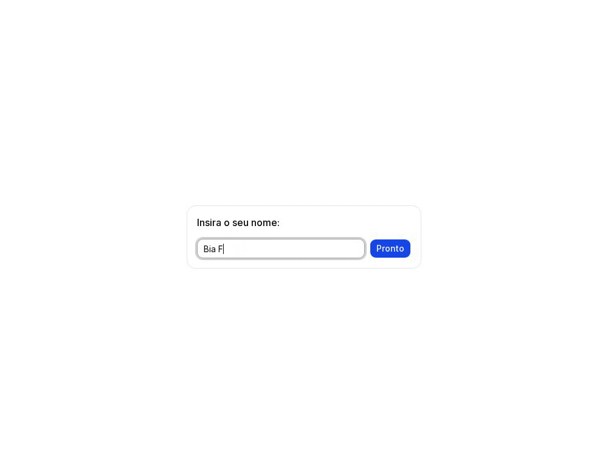
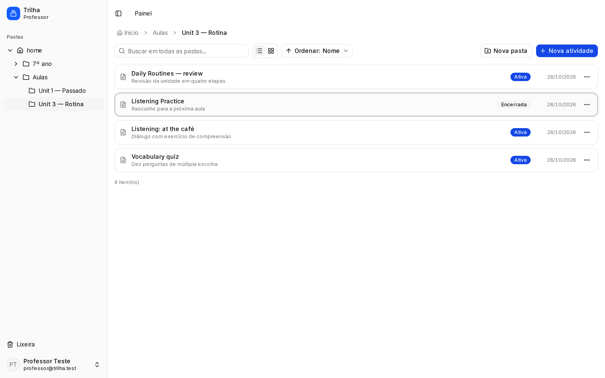
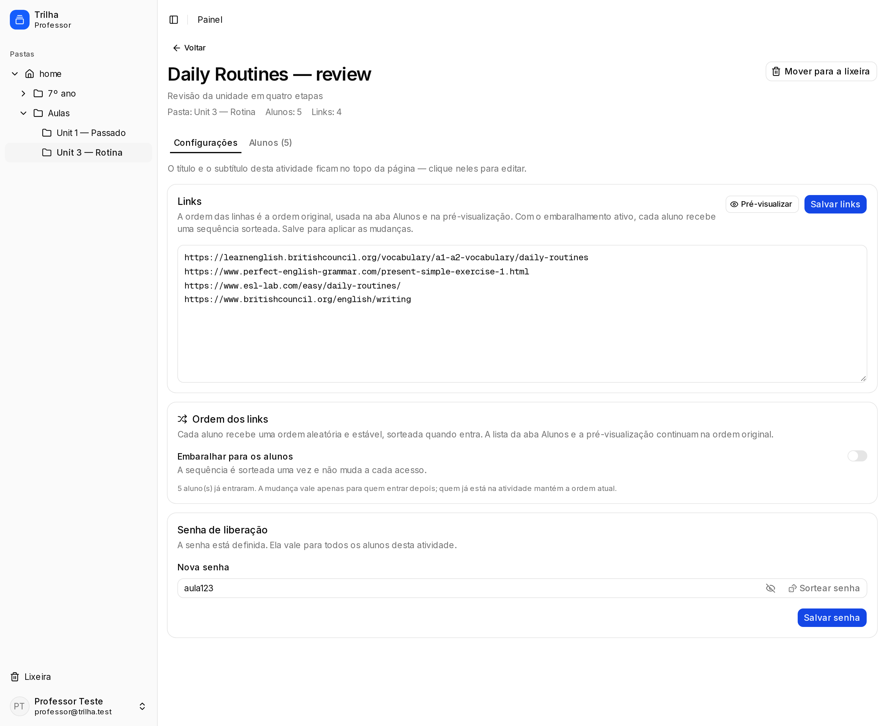
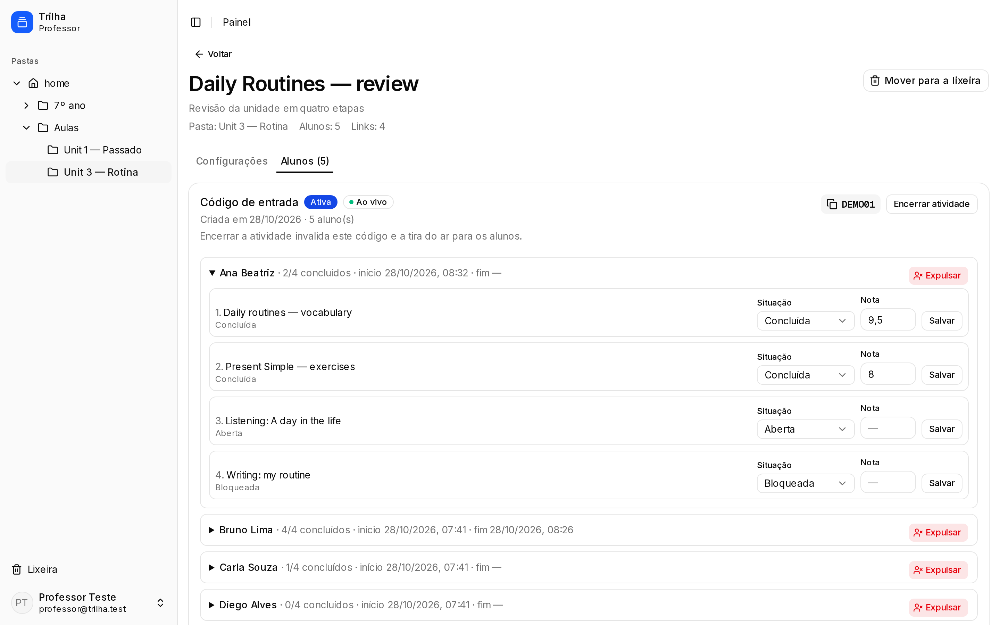
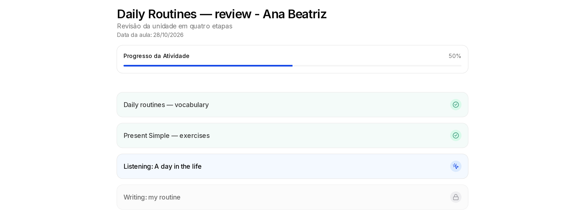
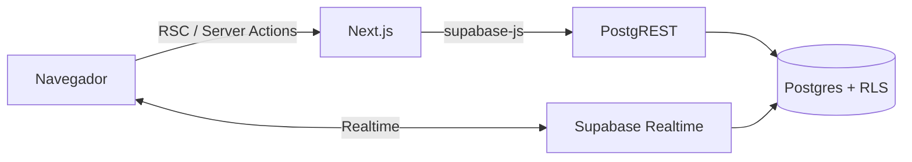

# Trilha

[](https://github.com/giuliovalcanaia/trilha/actions/workflows/ci.yml)

Ferramenta de apoio à sala de aula: o professor monta uma sequência de
atividades — uma **trilha** de links — e os alunos avançam sozinhos, uma etapa
por vez, enquanto ele acompanha o progresso em tempo real.

**Por que existe:** em aula no laboratório de informática, as atividades prontas
que se encontram na internet costumam durar 5 ou 10 minutos. Terminada uma, o
aluno para e espera o professor ir até a máquina colar o próximo link — a aula
vira uma fila de recados. O Trilha resolve isso: o professor deixa a lista
inteira pronta antes da aula, cada etapa é liberada com a senha que ele combina
com a turma (opcionalmente com uma nota) e o aluno só avança quando conclui a
anterior. Assim ele tem autonomia para puxar a próxima atividade enquanto o
professor revisa e libera o que já foi entregue.

O aluno não cria conta: digita o código da turma, coloca o nome e percorre os
links na ordem definida. Cada etapa é liberada com a senha da atividade, e a
nota é opcional. O professor organiza tudo em pastas, consulta o código de
entrada e vê o progresso (e as notas) sem recarregar a página — e pode corrigir
status e nota de qualquer aluno pelo painel.

Funciona para qualquer disciplina; o cenário de exemplo do repositório é de
inglês. Não há demo pública: as imagens abaixo vêm desse cenário
(`npm run docs:images`) e o app roda localmente em poucos minutos.

## Capturas

**Fluxo do aluno** — abre o link, erra a senha (o servidor conta as tentativas),
acerta e libera a próxima etapa:



**Acompanhamento em tempo real** — a lista de alunos se atualiza sozinha quando
o aluno conclui uma etapa, com status e nota por link:


| Explorador de pastas | Editor da atividade |
| --- | --- |
|  |  |
| **Acompanhamento dos alunos** | **Visão do aluno** |
|  |  |

## Funcionalidades

- **Explorador de atividades e pastas** com árvore na sidebar, busca global,
  seleção múltipla, arrastar e soltar, renomear, mover e duplicar. A troca de
  pasta é instantânea (o dataset é carregado uma vez por entrada no painel).
- **Editor de atividade** com links em sequência, senha de liberação, ordem dos
  links e opção de embaralhar a ordem por aluno.
- **Código de entrada** por atividade, com encerramento e reabertura.
- **Área do aluno** sem cadastro, com progresso por link, nota opcional e
  liberação por senha — com rate limit no servidor. O aluno puxa a próxima
  etapa sozinho, sem o professor precisar colar link.
- **Acompanhamento em tempo real** dos alunos e do progresso via Supabase
  Realtime, com correção de status e nota que também libera a próxima etapa.
- **Lixeira reversível** com restauração e exclusão definitiva.
- **Compartilhamento de pastas** entre professores, com acesso de editor.
- **Expulsão de aluno** com reinício do progresso ao entrar de novo.
- **Tema claro/escuro** (tecla `d` fora de campos de formulário).

## Stack

- [Next.js 16](https://nextjs.org) (App Router, Server Actions, Turbopack) e
  React 19
- [Tailwind CSS v4](https://tailwindcss.com) + [shadcn/ui](https://ui.shadcn.com)
  sobre [Base UI](https://base-ui.com)
- [Supabase](https://supabase.com): Auth (professor por e-mail/senha e aluno
  anônimo), Postgres com RLS e Realtime
- TypeScript estrito, ESLint e Prettier
- Testes com Vitest, pgTAP e Playwright; CI no GitHub Actions

## Como rodar localmente

Requisitos: **Node.js 20+**, Docker e a CLI do Supabase.

```bash
# 1. dependências
npm install

# 2. stack local do Supabase (API, banco e Studio)
npx supabase start

# 3. variáveis de ambiente
cp .env.example .env.local
# preencha com a URL e a publishable key impressas por `npx supabase status`

# 4. aplica as migrations e o seed
npx supabase db reset

# 5. app
npm run dev
```

A URL do app é impressa no terminal (por padrão, `http://localhost:3000`). O
Supabase local expõe a API em `http://127.0.0.1:54321` e o Studio em
`http://127.0.0.1:54323`.

### Credenciais do seed

O `supabase/seed.sql` cria dados de teste no ambiente local:

| Quem | Credencial |
| --- | --- |
| Professor | `professor@trilha.test` / `senha123` |
| Professor (compartilhamento) | `professor2@trilha.test` / `senha123` |
| Atividade de exemplo | “Daily Routines”, entrada `TESTE1`, liberação `aula123` |

> Essas credenciais só existem no stack local. Nunca rode `supabase db reset`
> contra o projeto remoto.

## Scripts

| Comando | O que faz |
| --- | --- |
| `npm run dev` | Servidor de desenvolvimento |
| `npm run build` | Build de produção (com checagem de tipos) |
| `npm run start` | Sobe o build de produção |
| `npm run lint` | ESLint |
| `npm run typecheck` | `tsc --noEmit` |
| `npm run format` | Prettier em `**/*.{ts,tsx}` |
| `npm run format:check` | Confere a formatação sem alterar arquivos |
| `npm test` | Testes de unidade (Vitest) |
| `npm run test:coverage` | Testes de unidade com cobertura (v8) |
| `npm run test:e2e` | E2E do fluxo principal (Playwright) |
| `npm run db:reset` | Recria o banco local com migrations + seed |
| `npm run db:test` | Testes de RLS e RPCs no banco (pgTAP) |
| `npm run db:lint` | Procura erros de schema/funções no banco local |
| `npm run docs:images` | Regenera as capturas de `docs/images` |

## Testes

- **Unidade** (`npm test`): funções puras de `lib/` — normalização de links,
  notas, árvore de pastas, seleção, datas e o extrator de prévia de links
  (incluindo o bloqueio de hosts privados).
- **Banco** (`npm run db:test`): pgTAP cobrindo a matriz de RLS (isolamento por
  professor e por aluno, compartilhamento de pastas) e o fluxo do aluno nas
  RPCs (entrada, conclusão com senha, rate limit, expulsão e retorno).
- **Ponta a ponta** (`npm run test:e2e`): um fluxo real no navegador —
  professor cria a atividade, aluno entra com o código e conclui, professor
  acompanha e encerra. Sobe o app e reseta o banco automaticamente.

O `npm run test:e2e` precisa do stack local no ar (`npx supabase start`).

## Arquitetura



- **Server Components leem, Server Actions escrevem.** Não existe API própria:
  a sessão vem dos cookies (`@supabase/ssr`), as actions validam com zod e
  devolvem um `ActionResult` tipado.
- **A RLS é a fronteira.** Nenhuma tela decide sozinha o que pode ser lido: as
  policies do Postgres checam dono/participação em cada linha.
- **Regras puras isoladas** em `lib/dominio/`, leituras tipadas em `lib/data/`,
  escritas por domínio em `app/*/actions/`.

Rotas, fluxo de uma escrita, helpers de autorização e o que é gerado por
ferramenta estão em [docs/architecture.md](docs/architecture.md).

## Decisões e trade-offs

- **Uma entrada por atividade.** A atividade nasce ativa e cria uma linha em
  `aplicacoes` com `turma_id = null` guardando o código. `turmas` existe para
  uma versão futura, mas nada usa hoje — preferi não inventar multi-turma antes
  de precisar.
- **Soft delete** (`deleted_at` + `trash_id`) em pastas e atividades, com
  lixeira, restauração e exclusão definitiva via RPC. Excluir uma pasta leva o
  conteúdo junto, mas nada some por engano.
- **Aluno anônimo** em vez de cadastro: menos atrito na aula e nenhum dado
  pessoal de menor de idade. O preço é que o progresso vive na sessão daquele
  navegador (expulsar + entrar de novo é o reset).
- **Senha da atividade** com bcrypt para validar e uma cópia em texto para o
  professor consultar. É um trade-off consciente: guardar só o hash obrigaria a
  redefinir a senha a cada esquecimento.
- **Rate limit no banco, não no cliente.** Senha errada e bloqueio voltam como
  payload porque uma exceção desfaria a transação e o contador de tentativas se
  perderia.
- **Navegação instantânea no explorador**: o painel carrega pastas e atividades
  uma vez e troca de pasta com History API, sem skeleton e sem ida ao servidor.

## Segurança

O isolamento mora no banco: a interface esconde o que o usuário não pode fazer,
mas quem decide é a RLS e as funções `security definer`. Abaixo, cada peça e
como ela é verificada.

### Isolamento por linha (RLS)

- **RLS em todas as tabelas públicas.** O professor vê as próprias pastas,
  atividades e alunos; o aluno vê apenas a própria participação e o próprio
  progresso. Nenhuma policy libera `select` sem uma condição de dono ou de
  participação.
- **Helpers de autorização no schema `private`**
  (`current_professor_id`, `professor_acessa_atividade`,
  `estudante_participa_*`), todos `security definer` com `search_path = ''`.
  Além de centralizar a regra, eles existem para evitar **recursão de RLS**:
  as policies de `atividades`, `aplicacoes`, `participacoes` e
  `progresso_estudante` chamam o helper em vez de fazer join entre si.
- **Compartilhamento de pastas** estende o acesso (e a edição) ao colaborador,
  mas a raiz compartilhada não pode ser movida nem excluída por quem recebeu o
  acesso — o `pastas_guard` responde `TRL22`.

### Aluno anônimo

- O aluno entra por **Supabase Anonymous Sign-Ins**: recebe um usuário `auth`
  anônimo, sem e-mail nem senha, e o progresso fica preso à participação dele
  naquela entrada. A tela do aluno escuta Realtime, que também passa pela RLS.
- Limites conscientes do modelo: quem tem o código entra; o nome é
  auto-declarado; e a sessão anônima não expira — expulsar e entrar de novo é o
  caminho de reset. Um novo login anônimo em outro navegador gera outra
  participação, com progresso zerado.

### Senha da atividade

- Guardada como **bcrypt** (`extensions.crypt` com `gen_salt('bf')`) e validada
  dentro do `complete_link`, no banco — nunca no cliente. A tentativa errada não
  grava nada: a senha é conferida antes da nota e do status.
- Existe também em texto (`atividade_senhas.senha_texto`) por um **trade-off
  consciente**: o professor precisa consultar a senha na aba Configurações e
  ditá-la para a turma; guardar só o hash obrigaria a redefini-la a cada
  esquecimento. A policy filtra por `private.professor_acessa_atividade`, então
  o texto é legível por professores com acesso à atividade (dono ou colaborador
  da pasta) e nunca pelo aluno.

### Rate limit do `complete_link`

- **5 erros seguidos bloqueiam a participação por 60 segundos**, inclusive para
  a senha correta; o acerto zera contador e bloqueio. O estado fica no banco
  (`participacoes.tentativas_senha` e `bloqueado_ate`), não no navegador — a
  validação no cliente é só feedback.
- Detalhe de implementação: senha errada e bloqueio voltam como **payload**
  (`{ ok: false, error }`) em vez de exceção, porque uma exceção desfaria a
  transação do RPC e o incremento do contador se perderia.

### Sessão do professor

- O login expira **24 horas após o início** (contagem fixa, não por
  inatividade). O `proxy.ts` compara `now()` com `session_started_at()` — RPC
  que lê `auth.sessions.created_at` da própria sessão — em `/painel*` e
  `/previa*`; ao expirar, faz `signOut`, apaga os cookies `sb-*` e redireciona
  para `/login?expirado=1`. Se a RPC falhar, o comportamento é fail-open.

### SSRF na pré-visualização de links

- `lib/link-preview.ts` roda no servidor e recusa hosts privados (localhost,
  `*.local`, `.internal`, IPv6 literal, 0/10/127/169.254/172.16–31/192.168/
  100.64–127/198.18–19), inclusive **depois de redirecionamentos**.
- Tem limite de 6 s por requisição, 512 KB de leitura, 4 redirecionamentos e só
  aceita `http(s)` com `text/html`.

### Superfície

- **Server Actions + RLS como fronteira.** Nenhuma chave privilegiada no
  cliente: só a publishable key, que é pública por definição. O app não usa
  `service_role`; toda escrita passa por server action (sessão validada + zod)
  ou por RPC que confere dono/participação.
- **Cabeçalhos de segurança** em todas as respostas (`next.config.ts`):
  `X-Content-Type-Options`, `Referrer-Policy`, `X-Frame-Options: DENY`,
  `Content-Security-Policy: frame-ancestors 'none'`, `Permissions-Policy` e
  `Strict-Transport-Security` (só em produção, para não travar o dev em http).
  `X-Powered-By` desligado.
- **`app/robots.ts`** mantém crawlers fora de `/painel`, `/atividade`, `/aluno`,
  `/previa`, `/login`, `/signup` e `/auth`.
- **Dependências**: `npm audit --omit=dev` sem vulnerabilidades; o Dependabot
  roda semanalmente (`.github/dependabot.yml`).

### Como isso é verificado

- **pgTAP** (`npm run db:test`, 70 asserções em `supabase/tests/`): isolamento
  entre professores, compartilhamento de pastas, visão do aluno, senha,
  rate limit, expulsão e retorno.
- **Vitest** (`npm test`): inclui a matriz de hosts privados do
  `link-preview` e os formatadores.
- **Playwright** (`npm run test:e2e`): fluxo completo no navegador.
- **CI** roda tudo isso a cada push (`.github/workflows/ci.yml`), mais
  `supabase db lint` e a cobertura mínima.
- Os **advisors** do Supabase foram rodados no projeto de produção: os avisos
  restantes são intencionais (RPCs `security definer` são a API, aluno anônimo é
  o modelo de uso e `pasta_compartilhamentos` sem policy significa acesso só por
  RPC). Fica recomendado ligar a *leaked password protection* em
  *Authentication → Password security*.
- **Limite de sign-in anônimo**: o padrão do Supabase é 30 por hora por IP. Para
  uma turma inteira no mesmo Wi-Fi, suba em *Authentication → Rate Limits* (não
  é configurável por arquivo).

## Estrutura

```
app/                     rotas (App Router)
  aluno/                 entrada do aluno
  atividade/             visão do aluno
  painel/                área do professor
    actions/             server actions por domínio
  previa/                pré-visualização da atividade
components/
  aluno/                 componentes da área do aluno
  auth/                  login, cadastro e shell de autenticação
  layout/                sidebar, navegação, tema
  painel/                componentes do painel
  ui/                    componentes gerados pelo shadcn/ui
docs/
  architecture.md        rotas, fluxo de dados, RLS e decisões
  images/                capturas geradas por `npm run docs:images`
e2e/                     fluxo Playwright
hooks/                   hooks reutilizáveis
lib/
  actions/               helpers das server actions (auth + zod + erros)
  auth/                  sessão de professor e de aluno
  data/                  leituras tipadas do banco
  dominio/               regras puras (links, notas, pastas, seleção)
  painel/                operações do painel
  supabase/              clientes browser/server e tipos do banco
  env.ts                 validação das variáveis de ambiente
  format.ts              formatação de datas
scripts/
  demo.sql               cenário usado nas capturas (não roda no db reset)
  capturas.mjs           gera PNG/GIF de docs/images
supabase/
  migrations/            schema, RLS e funções
  tests/                 pgTAP (RLS e RPCs)
  seed.sql               dados de teste
```

## Licença

MIT.
