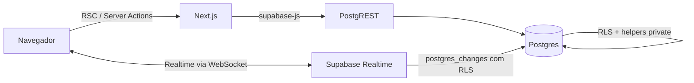

# Arquitetura

O Trilha é um Next.js (App Router) que conversa direto com o Supabase. Não há
API própria: **Server Components leem** e **Server Actions escrevem**, e o
Postgres decide o que cada sessão pode ver ou fazer via RLS. Este documento
explica o caminho de uma requisição, onde ficam as regras e o que é gerado por
ferramenta.

## Visão geral

- **Navegador**: componentes React. Não fala com o banco por conta própria além
  de Auth, Realtime e as RPCs que o servidor também usa.
- **Next.js**: Server Components montam as telas e Server Actions executam as
  escritas. A sessão vem dos cookies (`@supabase/ssr`).
- **PostgREST**: expõe tabelas e RPCs. Toda leitura/escrita passa pela RLS.
- **Postgres**: schema `public` (dados + RPCs) e schema `private` (helpers de
  autorização). As policies chamam os helpers em vez de fazer join entre
  tabelas protegidas — evita recursão de RLS.

## Rotas

| Rota | Quem acessa | O que faz |
| --- | --- | --- |
| `/` | público | formulário do código de entrada (`validate_join_code`) |
| `/aluno` | público | nome do aluno; cria a sessão anônima e chama `join_activity` |
| `/atividade` | aluno | trilha de links com progresso e liberação por senha |
| `/previa/[id]` | professor | prévia da atividade, sem gravar progresso |
| `/painel` | professor | explorador de pastas e atividades (home) |
| `/painel/pastas/[id]` | professor | conteúdo de uma pasta |
| `/painel/atividades/nova` | professor | criação (Configurações → Alunos) |
| `/painel/atividades/[id]` | professor | editor e acompanhamento dos alunos |
| `/painel/lixeira` | professor | restauração e exclusão definitiva |
| `/login`, `/signup` | público | sessão do professor (e-mail + senha) |
| `/auth/confirm`, `/auth/error` | público | confirmação de e-mail (dormente hoje) |

`/painel/pastas` redireciona para `/painel`. O gate de professor fica em
`app/painel/layout.tsx` (`requireProfessor`).

## Fluxo de uma escrita

1. O componente envia um `FormData` (ou argumentos) para uma **Server Action**
   em `app/painel/actions/*` ou `app/atividade/actions.ts`.
2. O wrapper `withProfessorForm` / `withProfessorCall`
   (`lib/actions/with-professor.ts`) resolve a sessão com `getProfessor`,
   valida o `FormData` com zod e executa o callback com `{ supabase,
   professorId }`.
3. A action chama uma **RPC** (`security definer`, que confere dono/participação)
   ou faz um `insert/update` que a RLS permite.
4. Erros de negócio voltam com SQLSTATE estável `TRLxx`; `falhaDeRpc` traduz
   para `ActionResult` (`{ error, code }`) e o cliente exibe a mensagem de
   `lib/dominio/erros.ts`.
5. `revalidatePainel()` (`lib/actions/revalidate.ts`) invalida as rotas
   afetadas.

Nas leituras, o caminho é mais curto: a página (Server Component) chama uma
função de `lib/data/*`, que recebe o `SupabaseClient` já criado e devolve dados
tipados. Erro de query vira `Error("<contexto>_lookup_failed")` e cai no
`app/error.tsx`.

## Onde ficam as regras

| Camada | Pasta | Papel |
| --- | --- | --- |
| Regras puras | `lib/dominio/` | links, notas, pastas, seleção, status, limites e schemas zod |
| Sessão | `lib/auth/` | `getProfessor`/`requireProfessor`, `getEstudante`/`getParticipacaoDoAluno` |
| Leituras | `lib/data/` | selects tipados (`ATIVIDADE_RESUMO`, …) por domínio |
| Escritas | `app/*/actions/` + `lib/actions/` | server actions por domínio, wrapper, `ActionResult` |
| Banco | `supabase/migrations/` | tabelas, RLS, helpers `private`, RPCs e triggers |

Helpers de autorização (`private.current_professor_id`,
`private.professor_acessa_pasta`, `private.professor_acessa_atividade`,
`private.estudante_participa_*`, `private.professor_owns_*`) são
`security definer` com `search_path = ''`. Eles existem por dois motivos:
centralizar a regra e **evitar recursão de RLS** entre `atividades`,
`aplicacoes`, `participacoes` e `progresso_estudante`.

RPCs do aluno: `join_activity`, `update_my_progress`, `complete_link`.
RPCs do professor: `set_activity_password`, `set_atividade_ativa`,
`set_student_progress`, `reorder_links`, `expel_student`, `share_folder`,
`unshare_folder`, `get_pasta_compartilhamento`, `duplicate_*`, `trash_*`,
`restore_trash`, `purge_trash`, `empty_trash`.

## Por que Server Actions

- **Sessão no servidor**: os cookies do Supabase são `httpOnly`; nenhum token
  privilegiado chega ao navegador. A publishable key é pública por definição.
- **Sem API intermediária**: cada escrita é uma função tipada que já valida
  entrada (zod) e devolve `ActionResult`. Menos superfície e menos código de
  transporte.
- **RLS como última linha**: mesmo que uma action seja chamada fora do fluxo
  esperado, o banco recusa o que a sessão não pode fazer. As RPCs repetem as
  checagens porque são chamáveis direto pelo PostgREST.

## Decisões que moldaram o código

- **Uma entrada por atividade**: cada atividade nasce ativa e cria uma linha em
  `aplicacoes` com `turma_id = null`, que guarda o código. `turmas` existe para
  uma versão futura, mas nada usa hoje.
- **Soft delete** em `pastas`/`atividades` (`deleted_at` + `trash_id`), com
  restauração e exclusão definitiva por RPC.
- **Aluno anônimo**: sessão do Supabase sem e-mail; o nome é auto-declarado e o
  progresso fica preso à participação.
- **Senha da atividade**: bcrypt para validar e texto apenas para o professor
  consultar (ver a seção de segurança do README).
- **Rate limit no banco**: `complete_link` devolve payload para senha errada e
  bloqueio, porque uma exceção desfaria a transação e o contador de tentativas.

## O que é gerado (não editar à mão)

- `components/ui/*`: componentes do shadcn/ui (estilo `base-nova` sobre Base UI).
- `lib/supabase/database.types.ts`: tipos do banco, gerados a partir do projeto
  Supabase. Regenere depois de aplicar migrations.
- `.next/`, `next-env.d.ts`, `*.tsbuildinfo`: saída do Next/TypeScript.
- `docs/images/*`: capturas geradas por `npm run docs:images`.
